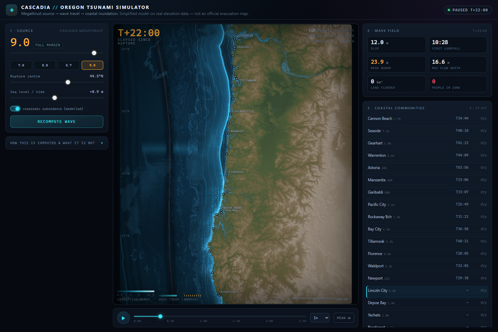

# Cascadia // Oregon Tsunami Simulator

Pick a Cascadia megathrust magnitude off the Oregon coast and watch the wave travel
across real bathymetry and flood the coast, minute by minute.

**Live:** https://nwfella.github.io/oregon-flood-simulator/



## What it does

- **Source** — a megathrust rupture on the Cascadia deformation front. Length scales as
  `L = 50·10^(0.65(M−7))` km (M9 ≈ 1000 km, full margin), slip from the seismic moment
  (`M₀ = 10^(1.5M+9.1)` N·m, μ = 35 GPa, 110 km downdip width), and the initial sea-surface
  displacement is 70% of slip spread over the seaward part of the rupture plane.
- **Propagation** — Huygens front over the real bathymetry (Dijkstra, local speed `√(g·h)`),
  emitted progressively along the rupture at 2.5 km/s. Amplitude evolves by Green's law
  (`h^−1/4`) plus path attenuation. Travel times fall out of the basin geometry.
- **Inundation** — shoreline runup from the shoaled amplitude through a breaking-limit
  saturation curve, modulated by local bay openness and slope from the DEM, plus tide and
  modelled coseismic subsidence (`0.15 × slip`, capped at 1.8 m). Flooding spreads inland by
  a static bathtub fill with a flow-front timing from `√(g·depth)`.
- **Animation** — WebGL2. Rupture front, 5-minute travel-time isochrones, travelling crest,
  depth-shaded inundation with an advancing foam edge, live per-town arrival times.

## Controls

Magnitude 6.6–9.2 · rupture centre 42–46 °N (click the map too) · sea level −1 to +3 m ·
coseismic subsidence on/off · play/pause · 0.5–8× · scrub · jump to peak.

## Data

Elevation and bathymetry: [AWS Terrain Tiles](https://registry.opendata.aws/terrain-tiles/)
(SRTM/NED on land, ETOPO offshore), 285 z=10 tiles composited and resampled to 723 × 900
cells (~520 m), quantised to 8 bits on a piecewise scale (1 m near sea level, 62 m in the
abyss) and baked into the page. Populations are rounded 2020 census figures.

Calibration targets: DOGAMI's Cannon Beach study (Witter et al.) puts CSZ runup at
**9–30 m** across source scenarios, 90% ≤ 16 m, preferred ~10 m, with M9.1 as the
maximum-considered event.

## Build & verify

```bash
python scripts/make_dem.py     # refetch tiles -> data/dem.json (cached in data/tiles/)
python scripts/build.py        # inject the DEM -> index.html
node scripts/verify_app.js     # 50 assertions: core isolation, physics, scaling, DEM
node scripts/browser_check.js  # 33 assertions in headless Chrome + screenshots
```

`index.html` is the whole app: no build step needed to run it, no network calls, no
dependencies. It works from `file://`.

## Limitations — read this before using it for anything

- **Not a hydrodynamic model.** No momentum, no wave breaking, no sediment, no vertical
  evacuation. It is a physically-scaled visualisation of hazard *geometry*.
- **520 m cells cannot resolve a 300 m berm.** Narrow coastal strips are averaged into
  their surroundings, so inundation is under-reported where the coast is steep — most of all
  south of Florence, which floods far less here than on the official maps.
- **"People in zone"** is population × the flooded fraction of each town's 2.5 km disc — an
  exposure indicator, not a casualty forecast.
- **Use the official maps** (DOGAMI tsunami inundation maps, NTHMP, local evacuation routes)
  for any real decision.

MIT licensed.
